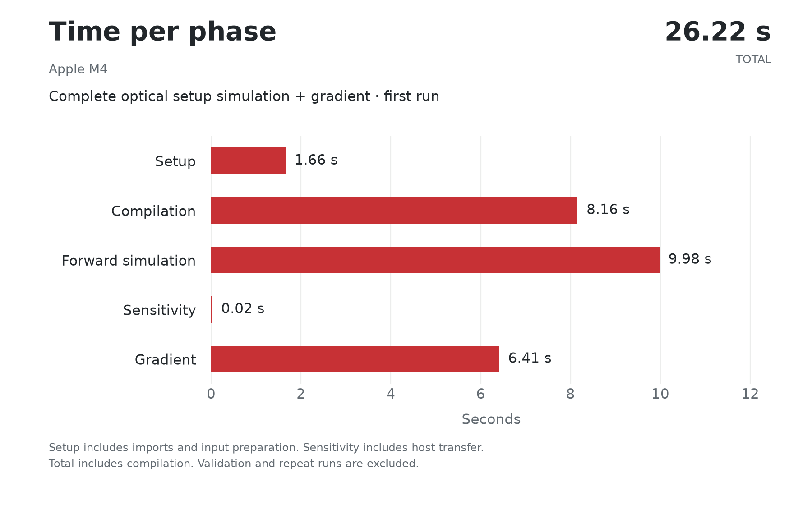

# Differometor 原版基准与操作过程报告

日期：2026-11-21  
项目：START Hack Munich 2026 — Faster Physics

## 1. 当前结论

已完成环境安装、入门示例运行、原版基准测量，并通过基准自带的正确性检查。基准记录显示源代码未修改。随后已创建 `optimize-simulator` 分支，开始阅读核心代码；目前尚未实施或验证任何性能优化。

| 核心指标 | 原版结果 |
|---|---:|
| 首次完整运行（包含编译，不含验证） | **26.223708 秒** |
| 热运行中位数（三次） | **12.450582 秒** |
| 全部追踪、转换和编译耗时 | 8.155907 秒 |
| 正确性检查 | PASS |

这些是本机原版对照数据，不代表优化后的成绩，也不能直接与不同硬件或 CPU 限制下的成绩比较。

## 2. 任务目标

在保持物理预测与梯度正确的前提下，加快完整仿真评估。固定工作量为一个保存的 3×3 光学装置、800–3000 Hz 范围内全部 101 个频率点，以及全部 193 个物理设计变量。保持双精度。

本次基准计算光场、信号、量子噪声、灵敏度、光功率、标量目标和梯度，不执行设计参数优化循环。比赛主要比较首次完整评估耗时；热运行时间单独报告。

## 3. 测试环境

| 项目 | 记录 |
|---|---|
| CPU | Apple M4 |
| 系统 | macOS 15.7.4，ARM64 |
| 主机逻辑 CPU 数量 | 10（不代表实际使用了全部核心） |
| CPU 绑定 | 未设置；本次不是 Linux 单逻辑 CPU 基准 |
| Python | 3.12.16 |
| Differometor | 0.0.6 |
| JAX / jaxlib | 0.9.0 / 0.9.0 |
| NumPy | 2.5.5 |
| 后端 | CPU |
| 双精度 | 开启 |
| 持久化编译缓存 | 关闭 |

项目位置：`/Users/yuechen/Desktop/start-hack-munich-2026`。

## 4. 已完成的过程

### 4.1 安装运行环境

使用项目内的 `.venv`，安装依赖并以可编辑方式安装项目。可编辑安装使后续源代码改动能够被该环境直接使用。

```bash
cd /Users/yuechen/Desktop/start-hack-munich-2026
source .venv/bin/activate
python -m pip install --upgrade pip
python -m pip install -r requirements.txt
python -m pip install -e .
```

终端显示 `Successfully installed differometor-0.0.6`。

### 4.2 跑通入门示例

```bash
python start_here.py
```

根据终端截图记录：

| 项目 | 秒 |
|---|---:|
| Setup | 12.290 |
| Compilation | 11.473 |
| Simulation + sensitivity + gradient | 17.763 |
| Total | 41.526 |

输出确认 101 个频率和 193 个梯度值；相对参考值的平均对数灵敏度为 `9.692e-08`。

入门示例将仿真和求导一起编译，正式基准采用分阶段方式，两者时间不能直接用于计算优化收益。平均指标接近零也不能替代逐频率检查。

### 4.3 运行正式原版基准

最初使用 `--cpus 1`，但 macOS 不支持该脚本要求的 Linux CPU 绑定接口，因此报错。随后移除此选项，成功执行：

```bash
python benchmark.py --repeats 3 --output benchmark-baseline.json
```

程序完成首次评估、三次热运行、自带正确性检查，并生成 JSON 报告与 PNG 图。

### 4.4 创建优化分支

```bash
git switch -c optimize-simulator
git status --short
```

截图确认分支创建成功，状态命令没有输出，即当时没有 Git 需要报告的文件变化。被忽略的生成文件仍可存在；创建分支不等于自动提交报告或未提交修改。

### 4.5 阅读核心代码

```bash
sed -n '1,125p' differometor/simulate.py
```

这一步只读取文件，没有修改程序。已理解两个核心步骤：

- `update`：提取元件参数，选择物理公式，计算系数并填入矩阵。
- `solve`：求解线性方程组，得到复数光场。

目前还没有定位到具体函数或代码行的性能瓶颈。

## 5. 首次完整运行的时间明细

下表直接取自保存的基准 JSON；单位为秒。

| 阶段 | 耗时 |
|---|---:|
| Python / library imports | 0.657532 |
| Initialize CPU backend | 0.012802 |
| Read and parse public inputs | 0.002705 |
| Build optical setup and prepare inputs | 0.982327 |
| Forward: trace / lower | 1.208071 |
| Forward: compile | 4.236405 |
| Forward simulation + AD residuals | 9.976687 |
| Sensitivity: trace / lower | 0.080248 |
| Sensitivity: compile | 0.067825 |
| Sensitivity, powers and scalar loss | 0.000574 |
| Gradient: trace / lower | 0.316576 |
| Gradient: compile | 2.246783 |
| Reverse-mode gradient | 6.411724 |
| Transfer results to host | 0.023451 |
| **首次完整运行总计** | **26.223708** |

总计包含导入、初始化、输入读取、模型构建、全部追踪与编译、正向仿真、灵敏度/功率/目标计算、梯度和结果传输。不包含验证、重复测量以及报告与图表生成，也不包含首个计时器启动前的解释器启动时间。

主要耗时集中在正向仿真（约 9.98 秒）、追踪与编译（约 8.16 秒）及梯度计算（约 6.41 秒）。这是阶段层面的证据，并不能直接证明某个函数就是瓶颈。

## 6. 热运行和中位数怎么算

首次执行后，同一进程复用已经准备和编译好的程序，再测量三次。每次仍重新执行物理计算和梯度计算，不是直接返回上次答案。

| 重复次数 | 耗时（秒） |
|---|---:|
| 1 | 13.607138 |
| 2 | 12.180455 |
| 3 | 12.450582 |

按从小到大排序：

```text
12.180455 < 12.450582 < 13.607138
```

中间的数就是中位数：**12.450582 秒**，约为 **12.451 秒**。三次的算术平均数约为 12.746058 秒，中位数与平均数不是同一个指标。

首次完整运行的 26.223708 秒包含准备与编译，不加入这三次热运行的中位数计算。热运行无需重复整套准备和编译，所以通常更快；此外执行阶段本身也会波动，因此不能简单用首次总时间减去编译时间，推算出精确的热运行时间。具体波动原因本次没有单独测量。

## 7. 正确性验证

| 检查项 | 记录 |
|---|---|
| 所有物理输出与梯度有限 | 通过 |
| 灵敏度参考检查 | 通过 |
| 最大绝对自然对数灵敏度误差 | 5.37304946135464e-06，小于 1e-5 |
| 梯度形状 | 193 个值 |
| 梯度范数 | 70517.11274737977，非零 |
| 梯度抽查参数 | mb11.tuning |
| 两个中心差分步长 | 0.001、0.0005 |
| 梯度抽查 | 通过 |
| 光场与信号类型 | complex128 |
| 噪声类型 | float64 |

`PASS` 表示通过了当前工作量上的内置检查。梯度数值抽查针对一个参数，不等于逐项独立验证了全部 193 个梯度，也不证明所有其他光学装置都正确。

## 8. 已知结论与待验证事项

**已确认：** 环境可用；原版完成完整工作量；内置检查通过；基准时间已保存；优化分支已建立。

**尚未完成：** 细粒度性能分析、算法改动、修改版测试、提速计算。

可研究元件公式分组、矩阵分解复用和中间数组内存开销，但这些都只是候选方向，尚未验证收益。

## 9. 后续实验流程

1. 确定一个具体优化假设。
2. 只做一个可审查的改动。
3. 使用相同机器和相同测试设置测量修改版，另存报告：

```bash
python benchmark.py --repeats 3 --output benchmark-candidate.json
```

4. 先确认正确性检查通过，再比较首次完整运行时间与热运行中位数。
5. 对较大数值改动增加输出数组或其他装置的对照；对有希望的提速重复测量，确认不是运行波动。

首次完整运行加速倍数 = 26.223707664990798 / 修改版首次完整运行秒数。

耗时降低百分比 = (1 - 修改版首次完整运行秒数 / 26.223707664990798) × 100%。

当前没有修改版数据，因此还不能报告加速倍数。

## 10. 数据来源与附件

- [原版基准 JSON](benchmark-baseline.json)：本报告计时、环境与验证数据的主要来源。
- [原版耗时图](benchmark-baseline.png)：同次运行生成。
- 入门示例时间、分支创建和代码查看过程来自用户提供的终端截图。

附件是原项目基准文件的副本，原文件仍保留在项目目录。报告未重新运行仿真，也未修改模拟器代码。


